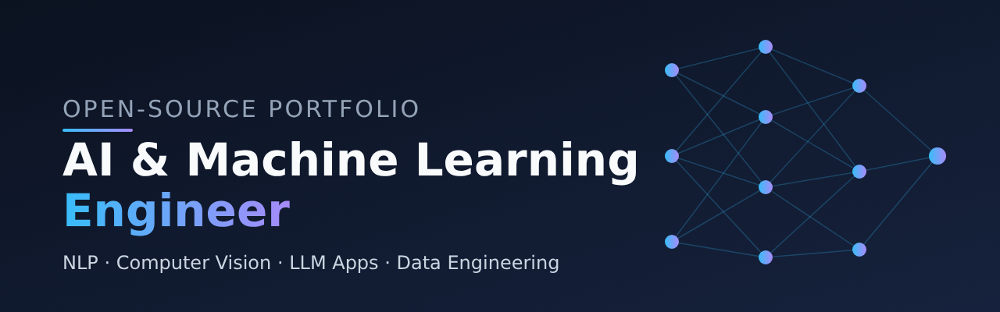

### Hi there 👋

I'm an AI/ML engineer focused on NLP, computer vision and LLM applications.
I'm building a public portfolio of end-to-end projects, committing code every day.

**🔭 Currently building**
- Classic ML pipeline with a small API
- Computer vision classifier
- RAG document Q&A app with evaluation
- A small transformer from scratch

**🛠️ Tech:** Python · PyTorch · scikit-learn · SQL · Git

**📌 Pinned projects below, each with a README, results and instructions to run.**
